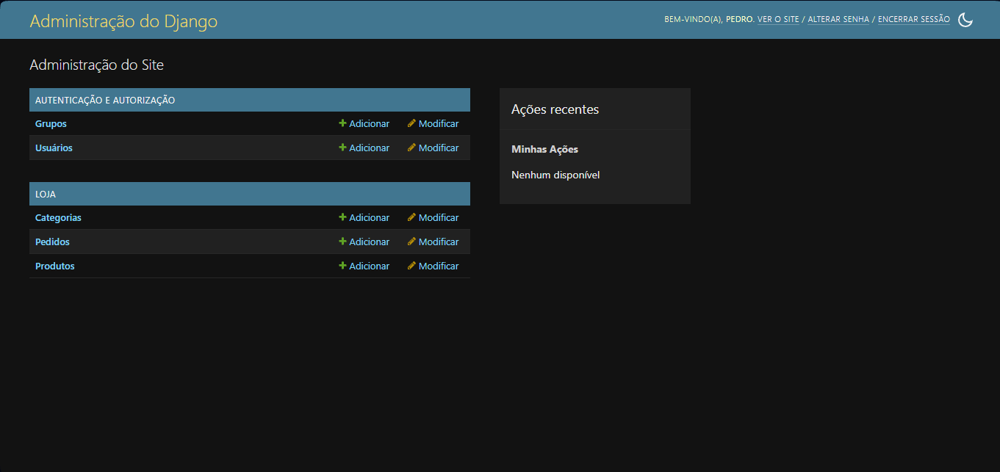
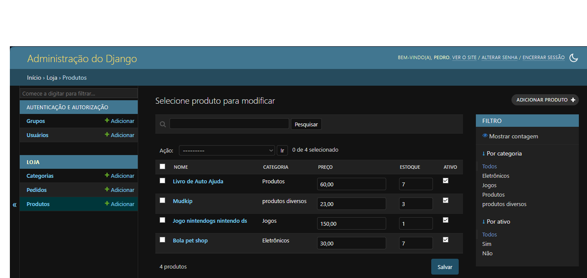
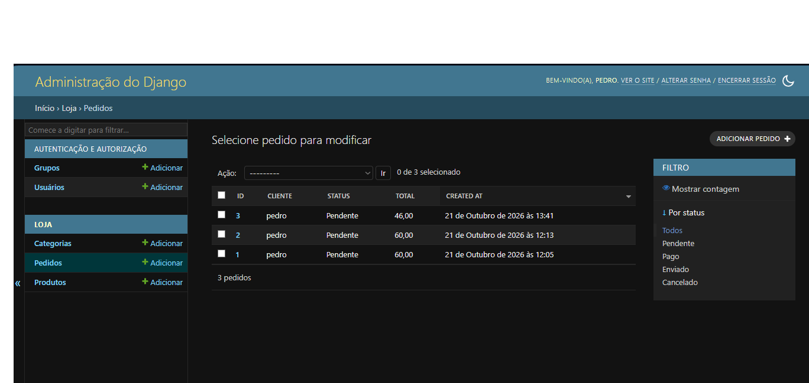

# Loja — Django + FastAPI + MySQL

Um único projeto, um único servidor ASGI:

| Rota        | Quem atende | Para quê                                  |
|-------------|-------------|-------------------------------------------|
| `/admin/`   | Django      | Painel: categorias, produtos, pedidos     |
| `/api/*`    | FastAPI     | API REST (docs em `/api/docs`)            |

O FastAPI reutiliza os **models, o ORM e os usuários do Django**
(`config/asgi.py` faz o roteamento entre os dois).

## Rodando

```bash
# 1. ambiente
python -m venv .venv
.venv\Scripts\activate          # Windows   (Linux/Mac: source .venv/bin/activate)
pip install -r requirements.txt

# 2. configuração
copy .env.example .env          # Linux/Mac: cp .env.example .env

# 3. MySQL via Docker
docker compose up -d

# 4. banco + usuário admin
python manage.py migrate
python manage.py createsuperuser

# 5. servidor
uvicorn config.asgi:application --reload
```

- Admin: http://localhost:8000/admin/
- Docs da API: http://localhost:8000/api/docs

> Sem Docker/MySQL por enquanto? Coloque `DB_ENGINE=sqlite` no `.env`.

## Endpoints

| Método | Rota                    | Acesso   |
|--------|-------------------------|----------|
| POST   | `/api/auth/register`    | público  |
| POST   | `/api/auth/token`       | público (retorna JWT) |
| GET    | `/api/auth/me`          | logado   |
| GET    | `/api/categories`       | público  |
| POST   | `/api/categories`       | admin    |
| GET    | `/api/products`         | público (`?q=`, `?category=`, `limit`, `offset`) |
| GET    | `/api/products/{slug}`  | público  |
| POST   | `/api/products`         | admin    |
| PATCH  | `/api/products/{id}`    | admin    |
| POST   | `/api/orders`           | logado (baixa estoque com lock) |
| GET    | `/api/orders`           | logado (só os seus) |
| GET    | `/api/orders/{id}`      | logado (só os seus) |

## Estrutura

```
config/   settings, urls, asgi.py (despacha Django x FastAPI)
shop/     app Django: models, admin, migrations
api/      app FastAPI: main, schemas, security (JWT), routers/
```

## Notas

- `mysqlclient` no Windows usa wheel pronta; no Linux precisa de
  `libmysqlclient-dev` e `pkg-config` antes do `pip install`.
- Em produção: `DJANGO_DEBUG=0`, `DJANGO_SECRET_KEY` forte,
  `python manage.py collectstatic` e `DJANGO_ALLOWED_HOSTS` com seu domínio.
- Endpoints FastAPI são `def` (síncronos) de propósito: rodam em threadpool,
  onde o ORM do Django é seguro. Evite ORM dentro de `async def` sem `sync_to_async`.

<div align="right">

🇧🇷 Português · 🇺🇸 English

</div>
🛒 Loja — E-commerce API with Django + FastAPI

Mostrar Imagem Mostrar Imagem Mostrar Imagem Mostrar Imagem

An e-commerce API where Django and FastAPI run together on a single server. Django provides the ORM, the admin panel and authentication; FastAPI exposes the REST API with automatically generated Swagger documentation.

<!-- Once you have the screenshots, save them in the docs/ folder with these names and remove the comment markers: ## Screenshots | Admin panel | API docs (Swagger) | |---|---| |  |  | -->
Features
Catalog: categories and products, with name search, category filter and pagination
JWT authentication, using the same users as the Django admin
Access roles: customers place orders; only admins create and edit the catalog
Orders with transactional stock updates: never sells more than what is in stock, even with concurrent orders
Product image upload with validation, resizing and metadata stripping
Admin panel with product thumbnails
Interactive documentation (Swagger/OpenAPI) at /api/docs
How it works
Client ──► uvicorn (ASGI) ──► config/asgi.py
                                 ├── /api/*   →  FastAPI   (api/ folder)
                                 └── others   →  Django    (admin, files under /media/)
                                                    │
                                         Models + ORM (shop/ folder) ──► MySQL

config/asgi.py decides which framework handles each request based on the URL prefix. FastAPI reuses Django's models, ORM and users, so there is no duplicated logic or tables.

Tech stack
Layer	Technology
Language	Python 3.11+
Admin, ORM and users	Django 5.2
REST API	FastAPI + Pydantic
Server	Uvicorn (ASGI)
Database	MySQL 8.4 (via Docker) or SQLite for quick tests
Authentication	JWT (PyJWT)
Images	Pillow
Static files	WhiteNoise
Running locally

Prerequisites: Python 3.11+ and, to use MySQL, Docker Desktop.

bash
# 1. Clone the repository
git clone https://github.com/YOUR_USER/loja-django-fastapi.git
cd loja-django-fastapi

# 2. Create and activate a virtual environment
python -m venv .venv
.venv\Scripts\activate            # Windows (Linux/macOS: source .venv/bin/activate)

# 3. Install dependencies
pip install -r requirements.txt

# 4. Create the settings file
copy .env.example .env            # Linux/macOS: cp .env.example .env

5. Choose a database

MySQL with Docker (default):
bash
  docker compose up -d

Wait about 30 seconds the first time. If you already have a MySQL installed on port 3306, change the mapping in docker-compose.yml to "3307:3306" and set DB_PORT=3307 in .env.

SQLite (quick test): set DB_ENGINE=sqlite in .env. No Docker needed.
bash
# 6. Create the tables and the admin user
python manage.py migrate
python manage.py createsuperuser

# 7. Start the server
uvicorn config.asgi:application --reload
What	URL
Admin panel	http://localhost:8000/admin/
API docs	http://localhost:8000/api/docs

On Linux, mysqlclient needs libmysqlclient-dev and pkg-config installed before pip install. On Windows it ships with a prebuilt package.

Environment variables (.env)
Variable	Description	Default
DJANGO_SECRET_KEY	Secret key (also signs the JWT tokens)	development key
DJANGO_DEBUG	1 for development, 0 for production	1
DJANGO_ALLOWED_HOSTS	Comma-separated allowed hosts	localhost,127.0.0.1
DB_ENGINE	mysql or sqlite	mysql
DB_NAME / DB_USER / DB_PASSWORD	MySQL credentials	loja / loja / loja123
DB_HOST / DB_PORT	MySQL address	127.0.0.1 / 3306
Endpoints
Method	Route	Access
POST	/api/auth/register	public
POST	/api/auth/token	public (returns the JWT)
GET	/api/auth/me	logged in
GET	/api/categories	public
POST	/api/categories	admin
GET	/api/products	public (?q=, ?category=, limit, offset)
GET	/api/products/{slug}	public
POST	/api/products	admin
PATCH	/api/products/{id}	admin
POST	/api/products/{id}/image	admin (uploads or replaces the image)
DELETE	/api/products/{id}/image	admin (removes the image)
POST	/api/orders	logged in (decrements stock)
GET	/api/orders	logged in (your own orders only)
GET	/api/orders/{id}	logged in (your own orders only)
GET	/api/health	public
Try it step by step
Create a category and a product (with price and stock) at /admin/.
Open /api/docs, click Authorize and sign in with your username and password (leave client_id and client_secret empty).
Use GET /api/products to see the product and note its id.
Use POST /api/orders with {"items": [{"product_id": 1, "quantity": 2}]}, replacing the product_id.
In the admin, check the created order and the reduced stock.
As an admin, upload a photo with POST /api/products/{id}/image. The product then shows its image_url.
Technical decisions
One server, two frameworks. config/asgi.py dispatches by URL prefix. FastAPI is imported only after Django has finished starting up, so it can use the models.
Synchronous endpoints (def). FastAPI runs them in a thread pool, where Django's ORM is safe to use. This avoids the SynchronousOnlyOperation error.
Consistent stock. Order creation runs inside transaction.atomic() with select_for_update(), which locks the product rows during checkout. Duplicate items are merged, stock is validated before the order is created, and the price is stored on the item (unit_price) at purchase time.
Authentication. JWT valid for 60 minutes, issued from Django users. The user is looked up in the database on every request, so a deactivated account loses access immediately.
Safe image upload. The API reads at most the size limit (2 MB) and opens the file with Pillow to confirm it is a real image, trusting neither the extension nor the Content-Type. It accepts only JPEG, PNG and WebP, downsizes to at most 1600 px and re-encodes the image, which strips metadata such as GPS data. Files are saved with random names, and the old image is deleted from disk when replaced or removed.
Project structure
├── config/              # settings, urls and asgi.py (dispatches Django vs FastAPI)
├── shop/                # Django app: models, admin and migrations
├── api/                 # FastAPI app
│   ├── main.py          #   application and router registration
│   ├── schemas.py       #   input and output models (Pydantic)
│   ├── security.py      #   JWT and access control
│   └── routers/         #   auth.py, products.py, orders.py
├── media/               # uploaded images (created at runtime, kept out of Git)
├── docker-compose.yml   # MySQL for development
├── requirements.txt
└── .env.example
Limitations and next steps
There are no automated tests yet.
In production, files under /media/ should be served by Nginx, a CDN or S3. Django serves them only with DJANGO_DEBUG=1.
In production, set your own DJANGO_SECRET_KEY, use DJANGO_DEBUG=0, run python manage.py collectstatic and configure DJANGO_ALLOWED_HOSTS.

Ideas for future versions:

 Automated tests and continuous integration (GitHub Actions)
 Shopping cart and checkout with simulated payment
 Web storefront consuming the API
 Deployment with cloud image storage
Author
### 🗂️ Categorias

**O que é:** as seções em que os produtos são organizados (por exemplo, "Ração", "Brinquedos", "Higiene").

**No painel:**
- A lista mostra **nome** e **slug**, em ordem alfabética.
- O **slug** (identificador para URL) é preenchido automaticamente enquanto você digita o nome.
- Há um campo de **busca por nome**.



**Regras:**
- Nome e slug são únicos.
- Uma categoria que ainda tem produtos **não pode ser excluída**. É preciso mover ou remover os produtos antes.

**Relação com a API:**
- `GET /api/categories`: lista as categorias (público).
- `POST /api/categories`: cria categorias (somente administrador).
- `GET /api/products?category=...`: filtra o catálogo por categoria.

---

### 📦 Produtos

**O que é:** o catálogo da loja. Aqui se controla o que está à venda, por quanto e em que quantidade.

**No painel:**
- A lista mostra **nome, categoria, preço, estoque e ativo**.
- **Edição direta na lista:** preço, estoque e ativo podem ser alterados sem abrir cada produto. Basta editar os valores e clicar em *Salvar* no fim da página.
- **Filtros laterais** por categoria e por produtos ativos/inativos.
- **Busca** por nome e por descrição.
- O **slug** é preenchido automaticamente a partir do nome.

**Campos:** categoria, nome, descrição, slug (único), preço (duas casas decimais), estoque, ativo e data de criação (automática, com os mais recentes primeiro).

**Regras:**
- O estoque nunca fica negativo.
- Desmarcar **Ativo** tira o produto de venda sem apagá-lo. Pedidos com produtos inativos são recusados.
- Produtos que já foram vendidos **não podem ser excluídos**, para preservar o histórico dos pedidos.
- O estoque é baixado quando um pedido é criado pela API e devolvido quando ele é cancelado.

**Relação com a API:**
- `GET /api/products` e `GET /api/products/{slug}`: consulta pública, com busca (`?q=`), filtro por categoria e paginação (`limit` e `offset`).
- `POST /api/products` e `PATCH /api/products/{id}`: criação e edição (somente administrador).



### 🧾 Pedidos

**O que é:** o registro das compras feitas pelos clientes pela API. É onde a equipe acompanha cada pedido.

**No painel:**
- A lista mostra **número, cliente, status, total e data**, com os mais recentes primeiro.
- **Filtro lateral por status.**
- Ao abrir um pedido, os **itens aparecem em uma tabela** dentro dele, com produto, quantidade e preço unitário.
- O **preço unitário é somente leitura**: ele é gravado no momento da compra, então mudar o preço do produto depois não altera pedidos antigos.
- O **total** é calculado automaticamente pela soma dos subtotais.




**Fluxo de status:**

```
Pendente ──► Pago ──► Enviado
   │          │
   └──────────┴──► Cancelado
```

| Status | Significado |
|--------|-------------|
| Pendente | Pedido criado, aguardando pagamento |
| Pago | Pagamento confirmado |
| Enviado | Pedido despachado (estado final) |
| Cancelado | Pedido cancelado, com estoque devolvido (estado final) |

**Como cada ação funciona pela API:**
- `POST /api/orders`: o cliente cria o pedido. O estoque é verificado e baixado dentro de uma transação, com bloqueio das linhas (`select_for_update`), então dois pedidos simultâneos nunca vendem a mesma unidade.
- `POST /api/orders/{id}/cancel`: o cliente cancela o próprio pedido, apenas se estiver pendente.
- `PATCH /api/orders/{id}/status`: o administrador avança o pedido para pago, enviado ou cancelado. Transições inválidas retornam erro 409.
- `GET /api/orders/admin/all`: o administrador lista todos os pedidos, com filtro por status e paginação.
- `GET /api/orders` e `GET /api/orders/{id}`: o cliente vê apenas os próprios pedidos.

> ⚠️ **Atenção:** para mudar o status de um pedido, use `PATCH /api/orders/{id}/status`. Ela valida a transição e devolve o estoque em cancelamentos. O campo de status no painel é editável, mas alterá-lo ali só troca o valor, sem aplicar essas regras nem mexer no estoque.

